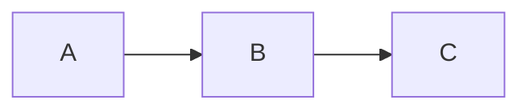

# dyno

A self-hosted documentation server — think GitBook or Notion, but as a single Go binary with zero external dependencies.

## Features

- **Markdown rendering** — GFM, footnotes, definition lists, syntax highlighting (200+ languages via Chroma)
- **Mermaid diagrams** — flowcharts, sequence diagrams, pie charts, and more
- **Full-text search** — built-in in-memory search with highlighted snippets
- **Repository Explorer** — opt-in `--explore` workspace with folders, advanced search, metadata filters, configurable columns, previews, overview and Markdown relationships; no AI or external search service
- **Auto-generated sidebar** — navigation tree built from the filesystem, no config needed
- **Light / dark mode** — persisted to localStorage
- **Table of contents** — per-page TOC with scroll spy
- **Prev / Next navigation** — automatic based on sidebar order
- **GitHub edit links** — "Edit this page" links pointing to your repo
- **Code blocks that follow the theme** — light and dark syntax highlighting, with optional macOS-style terminal chrome
- **Copy button** — one-click copy on every code block
- **Anchor links** — deep-linkable headings
- **Asset directories** — prefix a directory with `_` (e.g. `_images/`) to serve files without showing them in the sidebar
- **File downloads** — render safe per-site downloads with filename, MIME type, and size from `_downloads/`
- **Configurable base path** — run under any URL prefix (e.g. `/docs`, `/myapp/docs`, or `/`)
- **Library mode** — serve multiple documentation sites under one dyno instance with repeated `--site`
- **Local Markdown browser** — `dyno browse` opens selected files and recursive directories with a filesystem sidebar and search
- **Git-backed sites** — `--git-repo-site <url>` clones a repo and serves it; auto-pulls on a configurable interval
- **Document version compare** — compare any two Git revisions, the staged file, or the working tree in source and rendered views
- **Printable change report** — compare document revisions as added, removed and changed content blocks with before/after rendering, chapter context and a print/PDF view; frontmatter is always excluded
- **Library config file** — `--library dyno-library.yaml` describes multiple sites (local or git) with metadata overrides
- **Backlinks** — every page shows which other pages link to it
- **Ego-graph** — D2 dependency graph (±1 hop) for each page, accessible via the graph icon in the navbar
- **Tasks** — collects `- [ ]` / `- [x]` task items across all pages; section-scoped and global views
- **Comments and highlights** — optional local JSONL-backed comments, threaded replies, and selected-text highlights
- **Expanded reading** — animate the article into a distraction-free panel; restore with the same button or Escape, preserving reading position and respecting reduced motion
- **Hot reload** — `--watch` flag reloads navigation and search index on file changes
- **Dev mode** — `--dev` flag reloads templates from disk without rebuilding
- **Single binary** — UI assets are embedded; no Node.js is needed at runtime
- **Bundled UI assets** — Bulma CSS and Dyno styles are served locally, with no framework JavaScript
- **Optional MCP companion** — `dyno-mcp` exposes the same docs to AI agents over `stdio` or HTTP

## Project layout

```
.
├── dyno.yaml          # Site configuration
├── site/              # Your Markdown content goes here
│   ├── index.md       # Landing page
│   ├── _downloads/      # Files exposed only through file-download blocks
│   ├── getting-started/
│   │   ├── index.md
│   │   ├── _images/   # Assets (underscore prefix = hidden from sidebar)
│   │   └── ...
│   └── ...
```

## Site container image

Build a minimal self-contained Linux image containing the Dyno binary and one complete site directory:

```bash
just site-image registry.example.com/docs/my-site:latest /path/to/site
docker run --rm -p 8080:8080 registry.example.com/docs/my-site:latest
```

The complete directory, including dotfiles such as `.env` and `_downloads/`, is copied to `/site`. If `dyno.yaml` is absent there but exists in the parent directory, it is included automatically. The image uses `scratch`; the runtime contains only Dyno, CA certificates, and the site. Set `DOCKER_DEFAULT_PLATFORM=linux/amd64` or `linux/arm64` before building.

Warning: values from `.env` become part of the image layers. Do not use this recipe with secrets that must remain outside the image.

## Configuration

### `dyno.yaml`

Per-site configuration file in the site root:

```yaml
title: My Docs
description: Project documentation
version: 1.0.0
logo_text: MyProject
github_url: https://github.com/org/repo
github_branch: main
copyright: My Organization
base_path: /docs        # or "" for root
# Git auto-pull (when site is cloned via --git-repo-site)
git_pull_interval: 5m   # or "false" to disable
git_branch: main
api_proxy_allowed_hosts:
  - api.example.com
api_proxy_allow_private_networks: false
content_include:
  - "docs/**/*.md"
  - "README.md"
content_exclude:
  - "**/drafts/**"
frontmatter:
  display: [document-status, document-owner, document-tags, updated]
  fields:
    document-status:
      label: Status
      type: select
      options: [NEW, DRAFT, REVISION, FINAL]
      filterable: true
    document-owner:
      label: Owner
      type: text
      filterable: true
    document-tags:
      label: Tags
      type: tags
    updated:
      label: Source updated
      type: datetime
      readonly: true
      update_on_save: true
  defaults:
    nabidka-md-stav: INTERNAL_REVISION
    nabidka-md-analyza: 0
    nabidka-md-vyvoj: 0
```

All fields are optional — dyno works with no config file at all.

`api_proxy_allowed_hosts` limits the interactive API widget to an explicit host allowlist.
`api_proxy_allow_private_networks` controls whether the widget may call loopback/private targets; default is `true` for compatibility.

`content_include` and `content_exclude` limit which Markdown files are exposed in navigation, search, prev/next, and rendered pages. Patterns are slash-separated globs relative to the content directory; `**` matches across directories. Empty `content_include` means all Markdown files are included, and `content_exclude` always wins.

`frontmatter.fields` defines repository-specific metadata without hard-coding a vocabulary in Dyno. Supported types are `text`, `textarea`, `select`, `boolean`, `number`, `date`, `datetime`, and `tags`. `display` controls the preferred order, `readonly` prevents form edits, and `required` enables validation. `frontmatter.defaults` defines the fields that appear in the bulk metadata editor and provides the suggested values for the `Fill defaults` action. For `date` and `datetime` fields, `update_on_save: true` writes the current server date or RFC 3339 timestamp whenever the document content is actually changed. Setting `filterable: true` adds a runtime facet to the sidebar, navigation, and full-text search in normal, edit, and library modes. Facet values and document counts are indexed at startup; values within one field use OR and different fields use AND. Filters are working views stored in the URL, not publication or access restrictions. Applying the editor form patches only changed top-level fields; unknown YAML and untouched complex blocks remain unchanged. The same `frontmatter` block can be configured per site in `dyno-library.yaml`.

### `dyno-library.yaml`

Describes a collection of sites for library mode. Use with `--library`:

```yaml
title: My Library
work_dir: ~/tmp/dyno-wrk   # writable dir for git clones (overridden by --work-dir)

sites:
  # local directory
  - path: ./local-site
    title: Local Docs
    slug: local
    icon: 📁
    color: "#6366f1"

  # git repo
  - url: https://github.com/org/devops
    title: DevOps Handbook
    slug: devops
    icon: 🚀
    color: "#f97316"
    branch: main
    pull_interval: 10m
    content_include:
      - "docs/**/*.md"
      - "README.md"
    content_exclude:
      - "**/drafts/**"

  - url: https://github.com/org/go-cookbook
    title: Go Cookbook
    slug: go
    icon: 🐹
    color: "#066fd1"
```

Each entry uses either `path` (local directory) or `url` (git repo), never both. Metadata fields (`title`, `slug`, `icon`, `color`, …) are fallbacks — `dyno.yaml` inside the site always wins.

**Priority:** `dyno.yaml` inside site > `dyno-library.yaml` entry > defaults.

## Building

Requires **Go 1.22+**.

### Development

The UI uses locally embedded Bulma 1.0.4 CSS, native dialogs, and Dyno's own
JavaScript. Light/dark colors are shared through `--dyno-*` tokens in
`assets/app.css`; the visual editor uses the same palette. `just assets-refresh`
refreshes vendored assets using the Bulma version pinned in `justfile`.

CodeMirror 5 modes are shared by the reader, live preview, and editors through
`assets/syntax.js` and the generated `assets/syntax.min.js` bundle. Chroma remains
the server-side fallback for disabled JavaScript and unsupported languages.
`just editor-assets` rebuilds both the syntax bundle and the visual editor.

```bash
go run . --site ./site --dev --watch
go run . --site ./site --dev --edit
go run . --site /path/to/wiki --dev --watch
go run . --version
go run ./cmd/dyno-mcp serve --transport stdio --site ./site
```

The editor opens with **Contents | Visual editor | Live Preview**. Click an API block in Visual to edit its method, URL, headers, and advanced options in a **Form / Source** dialog. Placeholders stay literal, and blocks with unsupported form content open in Source so their content is preserved. **Apply** updates the block; **Save** saves the document. Switch to the main **Source** editor for front matter and other custom blocks; the visual editor preserves these blocks when editing surrounding text. The visual editor assets are committed and embedded in the Go binary. When changing their source files, rebuild them with `just editor-assets` (requires Node.js and npm).

### Local Markdown browser

Use `browse` without configuring a documentation site:

```bash
dyno browse README.md
dyno browse ./docs ./notes ./TODO.md
dyno browse . --exclude '**/archive/**'
dyno browse ./docs --edit --port 3001 --no-open
```

Paths may be Markdown files (`.md` or `.markdown`, case-insensitive) or directories. With no paths, the current directory is used. Directories are scanned recursively and displayed with their original names; duplicate and overlapping selections are merged. Draft documents are included, and `dyno.yaml` and `.pages` publication rules are not loaded. `README.md`, `index.md`, and `_group.md` remain ordinary documents. A single file opens directly; directory selections open a generated overview.

The server listens only on `127.0.0.1`, chooses a free port, opens the web browser, and watches for changes by default. Use `--port` for a fixed port, `--no-open` to print the URL without launching a browser, `--no-watch` to disable automatic refresh, and `--edit` to enable the Markdown editor. Watch updates rebuild navigation and search and refresh the reader; the editor is not automatically reloaded, and its revision checks protect against overwriting external edits.

Local links only resolve to documents in the explicit selection, including links between selected roots. A standalone file does not grant access to sibling Markdown documents or arbitrary attachments: only referenced images under its parent directory are served. Directory selections allow referenced attachments within those roots. Missing, excluded, or out-of-selection links show an explanation instead of adding sources automatically. Symlinks passed explicitly are resolved once; symlinks inside selected directories are skipped and cannot escape the selection when a file is read or edited.

Recursive scans skip hidden entries and `node_modules`, `vendor`, `target`, `dist`, `build`, `venv`, and `__pycache__`. Other underscore-prefixed directories are included. Repeat `--exclude` to add slash-separated globs relative to each selected directory; `**` matches nested directories. Explicitly selected files are included even when their names would otherwise be skipped by a recursive scan.

### Automated binary releases

GitHub Actions (`.github/workflows/release.yml`) and GitLab CI (`.gitlab-ci.yml`)
publish a release when `VERSION` changes on `main` (the default branch on GitLab).
Use a version such as `0.20.2`; the pipeline creates the matching `v0.20.2` tag.
Both pipelines run `go test ./...` before packaging. They use committed embedded
assets, without downloading new frontend versions or requiring Node.js.

Each `dyno-<version>-<os>-<arch>.tar.gz` contains `dyno`, `dyno-mcp`, both README
files, and the MIT license. Targets are macOS (`darwin`) and Linux for `amd64`
and `arm64`, and Windows for `amd64` (with `.exe` binaries). `SHA256SUMS` verifies
the archives. Build metadata includes the version, commit, and UTC build time.

GitHub uses its built-in `GITHUB_TOKEN` with `contents: write`. GitLab uses
`CI_JOB_TOKEN`, stores downloads in the Generic Package Registry, and links them
from the release; enable Packages and Releases and allow the pipeline user to
create the `v*` tags if they are protected. No personal token or changelog push
is required. GitLab builds and publishes archives in the same job, uploading
each archive directly to the registry rather than bundling them as a large CI
artifact. Only release notes and checksums are retained as CI artifacts for
30 days; published packages are independent of that expiry. Package cleanup
policies must retain release files.

For a retry, run the GitHub workflow manually or use GitLab **Run pipeline** on
the default branch. Existing releases are updated only when their tag points to
the same commit; a new commit needs a new `VERSION`. The pipelines do not rewrite
Git history or modify `CHANGELOG.md`.

Build the same packages locally from the repository root (Go, Bash, Git, tar,
and `shasum` are required):

```bash
bash scripts/ci_release_notes.sh
bash scripts/ci_package_release.sh
```

Outputs are in `dist/release/`. GitLab publication also requires curl and jq;
GitHub publication uses the GitHub CLI.

### macOS

```bash
git clone https://github.com/martinmares/dyno
cd dyno
just release-macos
./dyno --site /path/to/your/docs
```

Or install directly:

```bash
go install github.com/mares/dyno@latest
```

### Linux

```bash
git clone https://github.com/martinmares/dyno
cd dyno
just release-linux
./dyno --site /path/to/your/docs
```

Cross-compile from macOS/Windows:

```bash
GOOS=linux GOARCH=amd64 go build -o dyno-linux-amd64 .
```

### Windows

```powershell
git clone https://github.com/martinmares/dyno
cd dyno
go build -o dyno.exe .
.\dyno.exe --site C:\path\to\your\docs
```

Cross-compile from macOS/Linux:

```bash
GOOS=windows GOARCH=amd64 go build -o dyno-windows-amd64.exe .
```

## Usage

```
dyno [flags]

Flags:
  -p, --port string             Port to listen on (default "3000")
  -s, --site stringArray        Content directory (repeat for library mode) (default ["./site"])
      --git-repo-site string    Git repo URL to clone and serve as a site (repeatable)
      --work-dir string         Writable directory for git clones (required with --git-repo-site)
      --library string          Path to dyno-library.yaml with site list and metadata (cannot be combined with --site or --git-repo-site)
      --enable-comments         Enable page comments
      --interactive-tables      Force sorting and filtering for all Markdown tables, overriding front matter
      --comments-file string    JSONL file for comments (default: <site-root>/.dyno-comments.jsonl)
      --comments-management string  Comment management: disabled, author, or all (default "disabled")
      --dev                     Dev mode: reload templates and assets from disk on every request
      --watch                   Watch site for changes and reload navigation/search (single-site only)
      --explore                 Open Repository Explorer (single-site, opt-in)
      --log-format string       Log format: text or json (default "text")
      --version                 Print version and exit
```

`--site` always points directly to the content directory, for example `./site` or `/path/to/wiki`.

Use `--interactive-tables` to enable sorting and filtering for every Markdown table in every document, including nested tables in admonitions and editor previews. The flag applies to all sites in library mode and is also available with `dyno browse`:

```bash
dyno --site ./site --interactive-tables
dyno --library dyno-library.yaml --interactive-tables
dyno browse ./docs --interactive-tables
```

This flag overrides document settings, even `dyno.tables.sortable: false` or `dyno.tables.filter: false`. Without it, the document's `dyno.tables` front matter controls interactivity as before; ordinary tables stay static.

`--library` is exclusive with `--site` and `--git-repo-site`: when you use a library file, define all books inside `dyno-library.yaml`. `--work-dir` may still be used to override the library file's `work_dir` for git-backed entries.

If a section directory has no `index.md`, dyno serves a synthetic landing page with links to child pages.

### Repository Explorer

```sh
dyno --site ./site --explore --watch
```

Explorer is available through the **Explorer** toolbar link or `/_explore`
(under `base_path` when configured). The home page and all document URLs remain
in the reader. Explorer currently supports a single site, not
library mode or `dyno browse`. Editing still requires the separate `--edit` flag.

Use accent-insensitive words or quoted phrases, all/any matching and title,
URL-path or content scope. Combine search with the folder tree and fields marked
`filterable` in `dyno.yaml`. Results have 50 rows per page; columns and metadata
sorting come from configured frontmatter fields. **More filters** supports missing
values, no incoming Markdown links and inclusive date ranges for configured
`date`/`datetime` fields. Selected documents show an excerpt, the first chapters,
configured metadata and site-wide incoming/outgoing links. Open document includes
an Explorer return link; filters, columns, sorting, pagination and selection live
in the URL. Pane scroll is restored locally in the browser session.

**Overview** counts the same filtered selection. File modification times are
filesystem times, not Git commits or frontmatter dates; unfilled metadata and
unreferenced documents are signals, not automatic errors. **Relations** lists
actual Markdown links within the selection and aggregates them by top-level
folder, without inferring arbitrary frontmatter relationships. Only published
navigation entries are included. Use `--watch` for external changes; editor saves
invalidate the Explorer snapshot. No file contents are modified by Explorer.

### Change Reports

Open **Compare versions**, select two revisions of the document, and choose
**Change report**. The report shows counts and a linked list of changed blocks,
with chapter context and rendered before/after content. Unchanged blocks and
frontmatter are excluded. It works with the same validated document history,
including renamed files, staged content and the working tree. Use
**Print / Save PDF** or Ctrl+P to share a reader-oriented report.

The comparison is deterministic, not AI-generated: paragraphs, lists, tables,
callouts and fenced code are compared as Markdown blocks. Formatting-only edits
may therefore appear as changes; moved blocks may appear as removal/addition.
Linked assets are loaded from the current site, not archived with each revision.
Reports do not require `--explore` or `--edit`; Git history must be available.

### Examples

Use the **Print / Save PDF** toolbar button or your browser's print shortcut to
print a clean A4 document without navigation, comments or table controls.
Printing uses a light palette even in dark mode, includes all filtered table
rows and expands collapsed sections; the original reading state is restored
after closing the print dialog. The printout includes a local print timestamp,
the relative Markdown source file path, and a linked table of contents. It does
not depend on frontmatter field names. Page numbering
is left to the browser. For a clean PDF, disable the browser's own
headers and footers in its print settings.

Run `dyno examples` for a built-in cookbook with commands, YAML configuration,
and Markdown examples. Use `dyno examples browse` (or `serve`, `edit`, `library`,
`git`, `comments`, `config`, `markdown`, `mcp`) to read one topic. Terminal output
uses colored headings and indented SHELL/FILE blocks; redirected output keeps
the same layout without colors. Use `--plain` or `NO_COLOR` to disable colors,
or `--markdown` to export the original Markdown guide.
The source guide is [docs/examples.md](docs/examples.md).

```bash
# Serve one site
dyno --site ./site

# Serve a wiki directory directly
dyno --site /path/to/wiki --port 8080

# Library mode (multiple local sites)
dyno --site ./site --site ./site-demo-go

# Serve a git repo (cloned automatically, auto-pulled every 5 min)
dyno --git-repo-site https://github.com/org/docs --work-dir ~/tmp/dyno-wrk

# Library from a config file (local + git sites)
dyno --library dyno-library.yaml

# Development mode with live reload (single-site only)
dyno --site ./site --dev --watch

# Enable local comments
dyno --site ./site --enable-comments --comments-file ./comments.jsonl
```

Comments and highlights are stored outside Markdown files in append-only JSONL. Configure the frontmatter field that provides their stable document identity:

```yaml
comments:
  document_id_field: comment_id
```

Each commentable document must contain that field, for example `comment_id: architecture-123`. If an auth proxy sets `X-Auth-Request-User`, `X-Forwarded-User`, or `Remote-User`, dyno uses that as the author; otherwise the form author field is used.

Selecting rendered text opens an action dialog for adding a comment, creating a highlight, or cancelling. Highlights remain visible in the document and are also listed below the comments with `Go to` and `Delete` actions.

Annotation management is disabled by default. Use `--comments-management author` with trusted OAuth proxy headers to let users edit and delete their own comments and delete their own highlights. Use `--comments-management all` for explicit local/admin access to every annotation. Updates and deletions remain append-only JSONL events.

## Writing content

Place Markdown files inside `site/`. The sidebar is built automatically from the directory structure.

- Directories become section headers
- Files become pages
- Prefix filenames or directories with a number to control sort order: `01-introduction.md`, `02-setup/`
- `index.md` inside a directory becomes the landing page for that section
- Directories prefixed with `_` are hidden from the sidebar but their files are still served (useful for images)

**Linking between pages:**

```markdown
[Relative link](../other-page/)
[Absolute link](/getting-started/)    <!-- base_path is added automatically -->
```

**Images:**

```markdown

```

**MkDocs/PyMdown compatibility:**

Dyno renders MkDocs admonitions and collapsible details, including nested blocks. `???` starts closed, while `???+` starts open:

````markdown
???+ failure "Application must log"
    * Administrator activity
    * Security events

    !!! info "Included in the product :star:"
````

Supported MkDocs types are `note`, `info`, `tip`, `success`, `warning`, `todo`, `danger`, `failure`, `cite`, and `tldr`. GitHub-style alerts support `NOTE`, `INFO`, `TIP`, `IMPORTANT`, `WARNING`, `WARN`, `CAUTION`, and `DANGER`. PyMdown superscript such as `^4.1.8^` and the emoji shortcodes used by the imported MkDocs repositories are also supported. Fenced and inline code are left unchanged.

**Mermaid diagrams:**

````markdown

````

**Environment placeholders in Markdown:**

Uppercase placeholders are expanded before rendering from:
- `./.env`
- `./site/.env`
- process environment variables

Process environment variables win over both `.env` files.

````markdown
API base URL: {{HTTPBIN_URL}}

```api
{{HTTP_METHOD_FOR_GET}} {{HTTPBIN_URL}}/get
```
````

Interactive API widget variables stay untouched when written in lowercase or mixed case:

````markdown
```api
GET {{HTTPBIN_URL}}/anything/{{userId}}
Authorization: Bearer {{token}}
```
````

In that example:
- `{{HTTPBIN_URL}}` is expanded before render
- `{{userId}}` and `{{token}}` remain editable in the widget UI

For an endpoint with a self-signed TLS certificate, use the explicit `api-insecure` fence. It disables certificate verification only for that widget:

````markdown
```api-insecure no-auth
GET https://internal-api.example.test/status
```
````

The optional `no-auth` fence flag removes the Auth controls from the widget. It also works with a regular ```` ```api no-auth ```` block.

An API response can discover follow-up requests from JSON. Dyno evaluates the configured JSONPath after a successful response and creates callable API widgets without sending them automatically:

````markdown
```api-insecure no-auth
GET {{TSM_BASE_URL}}{{GENERATE_CONFIG_PATH}}/tsm-ticket
@follow-jsonpath: $[*].labels.__metrics_path__
@follow-method: GET
```
````

The supported JSONPath subset includes properties, array indexes, quoted properties, and `[*]`. Discovered relative paths, with or without a leading `/`, are resolved from the parent request origin. Absolute HTTP(S) URLs are preserved. Duplicate URLs are removed and at most 50 follow-up widgets are shown.

## dyno-mcp

`dyno-mcp` is a separate binary that exposes dyno documentation to AI agents over MCP while keeping the main `dyno` web server focused on HTML delivery.

Current design goals:
- one shared engine for both transports
- read-only tools only
- works in both single-site and library mode
- returns public dyno URLs so AI clients can surface clickable links back to the HTML docs
- exposes both MCP tools and MCP resources

### dyno-mcp usage

```bash
dyno-mcp serve [flags]
```

Flags:
- `-s, --site` repeatable, same semantics as `dyno`
- `--transport stdio|http`
- `--listen 127.0.0.1:8090` for HTTP mode
- `--path /mcp` for HTTP mode
- `--public-base-url https://docs.example.com`
- `--auth-token ...` or `DYNO_MCP_AUTH_TOKEN`
- `--allow-origin https://chat.example.com` repeatable in HTTP mode

Examples:

```bash
# Local stdio MCP for one site
go run ./cmd/dyno-mcp serve --transport stdio --site ./site

# Remote HTTP MCP endpoint for one site
go run ./cmd/dyno-mcp serve \
  --transport http \
  --site ./site \
  --listen 127.0.0.1:8090 \
  --path /mcp \
  --public-base-url https://docs.example.com

# Library mode MCP over HTTP
go run ./cmd/dyno-mcp serve \
  --transport http \
  --site ./site \
  --site ./site-demo-go/site \
  --listen 127.0.0.1:8090 \
  --path /mcp \
  --public-base-url https://docs.example.com
```

Implemented MCP tools:
- `list_books`
- `search_docs`
- `get_page`
- `get_navigation`
- `list_pages`
- `get_page_section`

Implemented MCP resources:
- `dyno://book/{slug}` — book metadata as JSON
- `dyno://book/{slug}/navigation` — navigation as JSON
- `dyno://book/{slug}/page?path=...` — raw Markdown for a page

HTTP compatibility notes:
- `POST` endpoint only for now; `GET` returns `405`
- returns `MCP-Protocol-Version: 2025-03-26`
- rejects unsupported `MCP-Protocol-Version` request headers with `400`
- when `--auth-token` or `DYNO_MCP_AUTH_TOKEN` is set, every HTTP request must send `Authorization: Bearer ...`
- when `Origin` is present, it must match one of the repeatable `--allow-origin` values

## License

Dyno is fully open source under the [MIT License](LICENSE). You may use, copy,
modify, distribute, and fork it, including for commercial purposes, subject to
the license terms. Third-party dependencies retain their own licenses.

## Support and Maintenance

The software is provided "AS IS", without warranty. Publication of this
repository does not establish a free community support service or an entitlement
to technical assistance, maintenance, bug fixes, new features, updates, response
times, or an SLA.

The upstream `main` branch is maintained by the project owner and explicitly
authorized maintainers. External pull requests may be submitted, but review,
responses, acceptance, and a release schedule are not guaranteed. These
maintenance policies do not restrict any rights granted by the MIT License.
